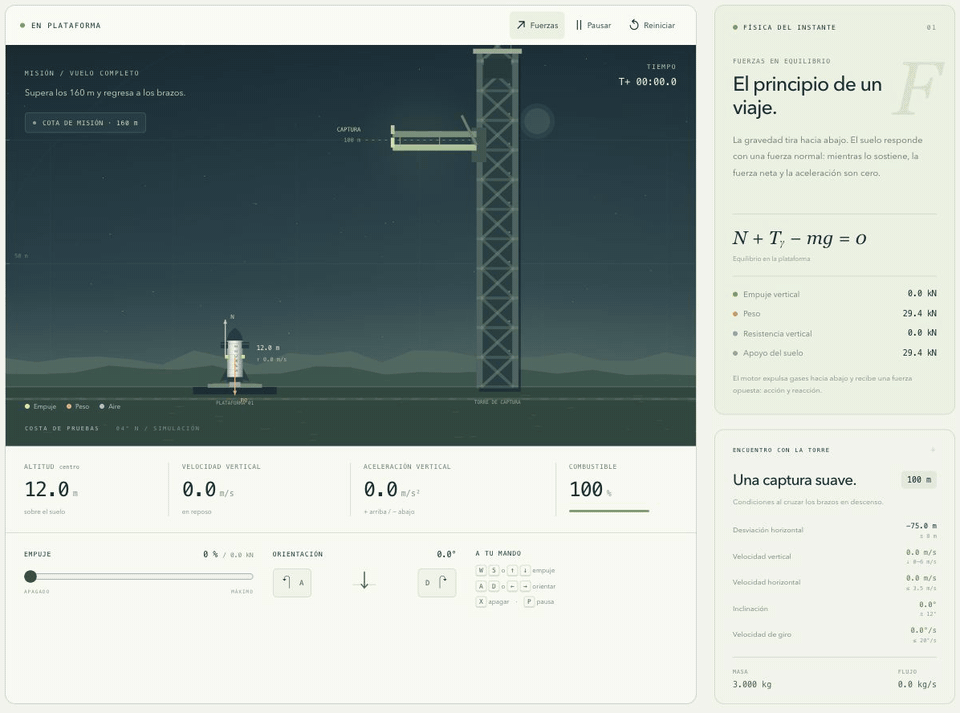
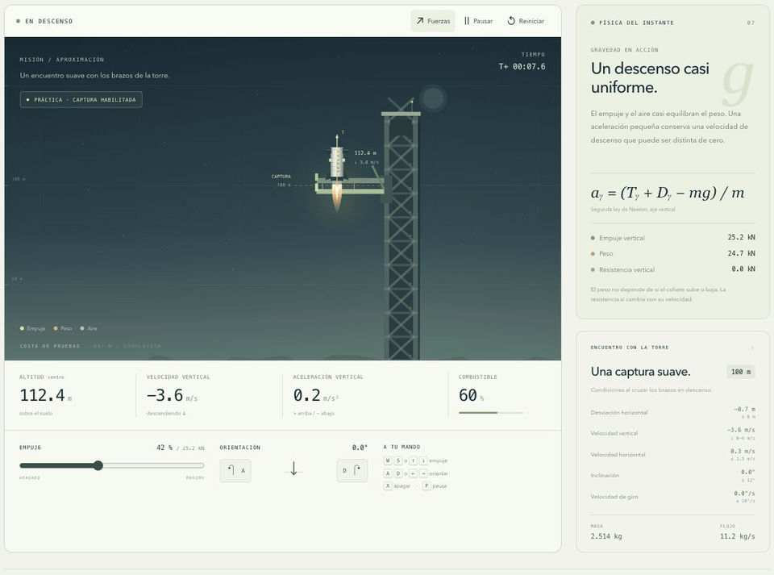

# SpaceE · La física de volver

Un juego educativo 2D en español: pilota un cohete reutilizable y regresa a los brazos de una torre. Las explicaciones acompañan lo que está ocurriendo, sin prescribir maniobras ni controlar el vehículo por ti.

## SpaceE en acción

**Despegue y ascenso por inercia.** Al apagar el motor, el cohete sigue subiendo mientras la gravedad y la resistencia del aire reducen su velocidad.



**Captura en la torre.** En el modo de aproximación, los brazos reciben el cohete al cruzar los 100 m en descenso, alineado y a baja velocidad.



## Ejecutar en local

Requiere Node.js 20 o posterior. No necesita instalar paquetes, claves, servicios externos ni recursos de Internet.

```sh
npm run dev
```

Abre [http://localhost:4173](http://localhost:4173). El servidor escucha exclusivamente en el equipo local. Para elegir otro puerto: `PORT=4174 npm run dev`. Detén el servidor con `Ctrl+C`.

## Jugar

- **Vuelo completo:** despega desde la plataforma, alcanza al menos **160 m** y regresa a la torre. La captura se evalúa al cruzar los **100 m** en descenso.
- **Aproximación:** comienza a **143 m**, descendiendo a **4 m/s**, con **800 kg** de combustible y **42 %** de potencia. Espera al botón de inicio; permite experimentar directamente con el regreso.
- Una captura necesita un centro a **±8 m** del objetivo, descenso de **0–6 m/s**, velocidad horizontal de **hasta 3.5 m/s**, inclinación de **±12°** y giro de **hasta 20°/s**.
- Los contactos con suelo, estructura o brazos fuera de los límites terminan el intento. El resultado explica la condición que falló y permite reiniciar.

| Control | Acción |
| --- | --- |
| `W` / `S` o `↑` / `↓` | Aumentar / reducir la potencia; se mantiene al soltar |
| `A` / `D` o `←` / `→` | Orientar; mantener la tecla para girar |
| `X` | Apagar el motor |
| `P` o espacio | Pausar / continuar |
| `R` | Reiniciar el escenario actual |
| `V` | Mostrar / ocultar vectores de fuerza |
| Deslizador y botones de giro | Controles de ratón o pantalla táctil |

Cuando el deslizador tiene el foco, las flechas ajustan su valor con el comportamiento accesible habitual; `A`/`D`, `W`/`S` y los atajos de letras siguen disponibles. Al cambiar de ventana o pestaña durante el vuelo se pausa automáticamente. Abrir «El modelo» también pausa el vuelo. Puedes leer la explicación y la bitácora sin consumir combustible.

La altitud se refiere al **centro del vehículo**. El eje vertical es positivo hacia arriba. La telemetría muestra altitud, velocidad y aceleración vertical, combustible, orientación, masa, caudal y fuerzas; el panel de captura añade velocidad horizontal y giro. Los vectores representan fuerzas, no velocidades: empuje verde, peso naranja, aire azul y apoyo gris.

## Física y alcance

Los parámetros son **valores elegidos para el juego**, no especificaciones de un vehículo real ni datos propietarios de SpaceX.

- Unidades SI: metros, segundos, kilogramos y newtons; paso fijo de **1/120 s** independiente del renderizado.
- `a = ΣF / m`: gravedad constante de **9.81 m/s²**, empuje orientable de **0–60 kN** y resistencia cuadrática opuesta a la velocidad.
- Masa seca de **1 800 kg** y combustible inicial de **1 200 kg** en la misión. El combustible consumido se descuenta de la masa.
- `ṁ = T / (Isp · g₀)`, con impulso específico elegido de **230 s**.
- `Faire = −½ρCdA |v| v`, con `CdA = 3.2 m²` y densidad `ρ = 1.225 exp(−h/8500) kg/m³`.
- Propulsores de actitud idealizados: aplican torque y amortiguan el giro al soltar el control, sin enderezar automáticamente el cohete. Su combustible no se modela.
- La plataforma incluye una guía vertical hasta el despegue. La captura usa un cruce interpolado entre pasos para no saltarse los brazos. El suelo y la torre usan una caja conservadora que considera la inclinación.
- La captura congela el vehículo al cumplir los límites; no reproduce la deformación, resistencia estructural o dinámica real de los brazos. No se modelan viento, sustentación, temperatura ni variación de gravedad.
- Área de juego: **±1 000 m** horizontales y **1 600 m** de altitud.

Las explicaciones contextuales cubren equilibrio y reacción normal, acción y reacción, segunda ley de Newton, inercia, apogeo, componentes del empuje, frenado durante el descenso, consumo de masa, impulso y energía cinética. La bitácora conserva los cuatro eventos más recientes.

## Verificación

```sh
npm test
```

La suite comprueba equilibrio, despegue, caída, resistencia, consumo y agotamiento de combustible, descomposición del empuje, giro, frenado, colisiones, límites de captura, estados finales y determinismo. Incluye dos vuelos integrados, de misión completa y aproximación, usando únicamente entradas de potencia y orientación. El piloto de prueba existe solo en los tests; el juego no tiene piloto automático.

Verificación manual en el navegador: inicio, potencia, telemetría, pausa, captura, fallo, reinicio, controles de giro, información del modelo y disposición móvil.

## Archivos

- `index.html` y `styles.css`: interfaz accesible y adaptable.
- `src/physics.js`: simulación determinista y explicaciones contextuales, sin acceso al DOM.
- `src/render.js`: paisaje, cohete, torre, cámara y vectores en Canvas 2D.
- `src/main.js`: entradas, pausa, telemetría, bitácora y ciclo de juego.
- `scripts/serve.mjs`: servidor estático local sin dependencias.
- `tests/physics.test.mjs`: pruebas numéricas y vuelos completos.

Primera versión local. No guarda progreso ni usa audio, cuentas, analítica o conexiones externas.
